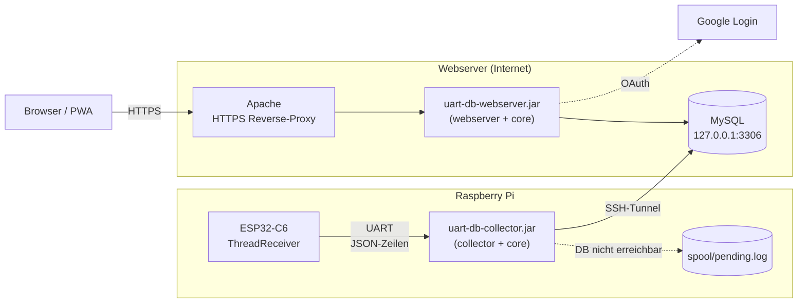
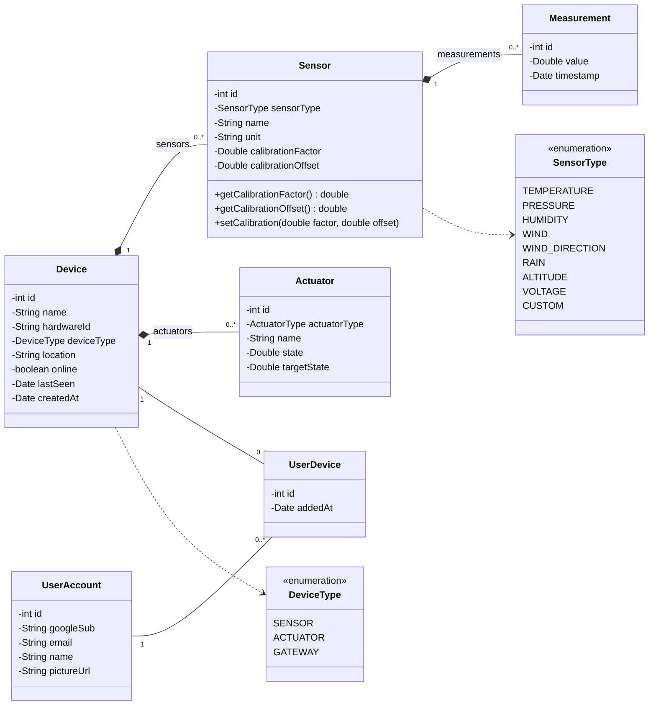
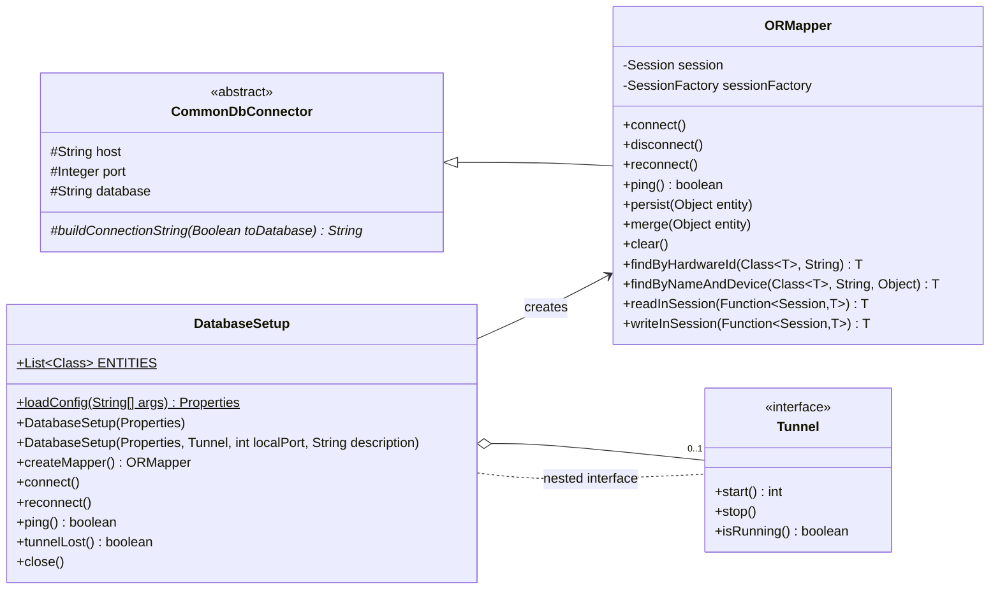
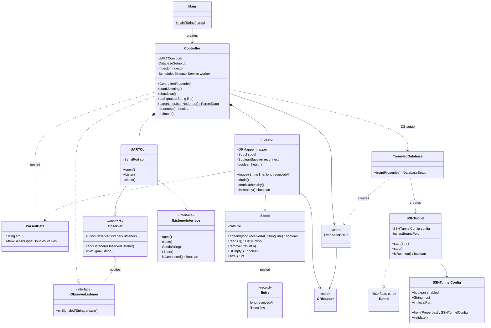
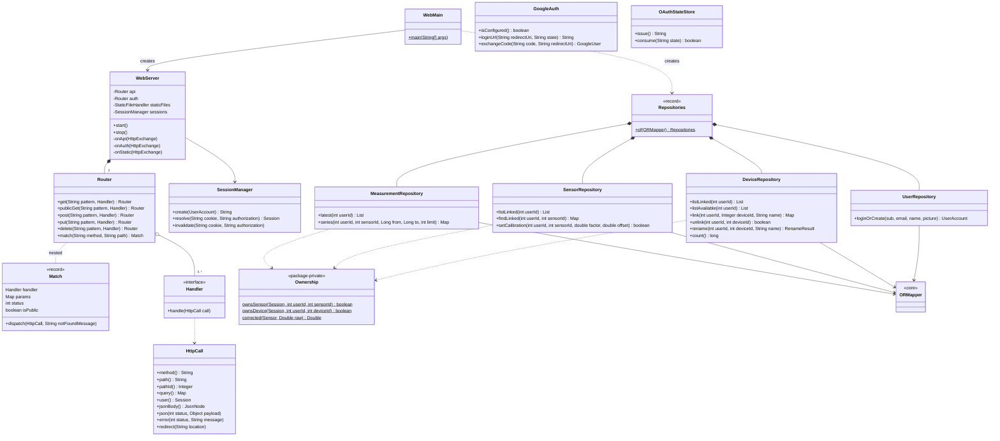
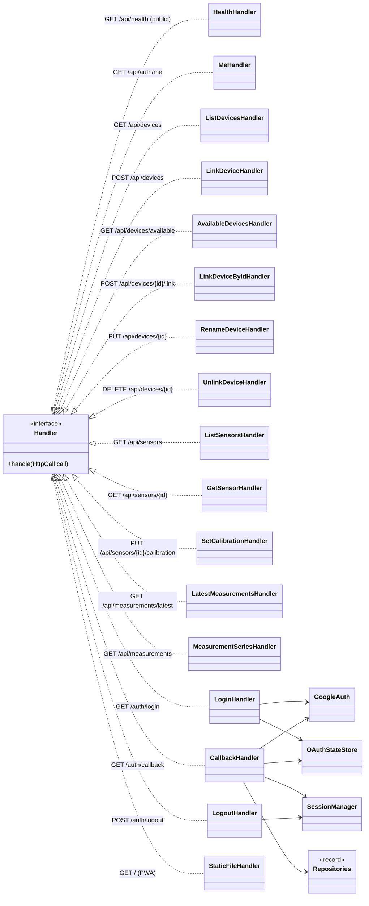

# UML

Klassendiagramme der beiden lauffaehigen Module (`collector`, `webserver`) und
der gemeinsamen Bibliothek (`core`). Die Diagramme sind Mermaid und werden von
GitHub und der IntelliJ-Markdown-Vorschau direkt gerendert.

Bewusst weggelassen: Getter/Setter der Entities, private Hilfsmethoden sowie die
ungenutzten Altklassen `ComStruct`, `DataPoint`, `IDatabase`, `MySQLConnector`.

## 1. Module und Verteilung

| Modul | Abhaengigkeiten | Inhalt |
|---|---|---|
| `core` | Hibernate, MySQL Connector/J | Entities, `ORMapper`, `DatabaseSetup` |
| `collector` | core, jSerialComm, Jackson, H2, JSch | UART-Empfang, Speichern, Puffer, SSH-Tunnel |
| `webserver` | core, Jackson | REST-API, Google-Login, PWA |

## 2. Domain-Modell (core)

## 3. Collector (Pi)

Ablauf einer UART-Zeile: `UARTCom` → `Controller.onSignaled` (Zeitstempel) →
Worker-Thread `db-writer` → `Ingestor.ingest` → Datenbank, bzw. bei Ausfall
`Spool.append`. Alle 30 s ruft `Controller.maintain` `Ingestor.drain` auf
(Tunnel/DB wiederverbinden, Puffer nachtragen).

## 4. Webserver

### Handler (Command-Pattern)

Jeder Endpunkt ist eine eigene `Handler`-Klasse im Paket `WebServer.Handlers`:

Ablauf einer API-Anfrage: `WebServer.onApi` setzt Sicherheits-Header und CORS →
`Router.match` → fuer nicht-oeffentliche Routen Session pruefen (401) →
`Match.dispatch` (404/405 oder Handler) → Handler nutzt `HttpCall` und die
`Repositories`; Fehler werden auf 400/413/500 ohne interne Details abgebildet.
